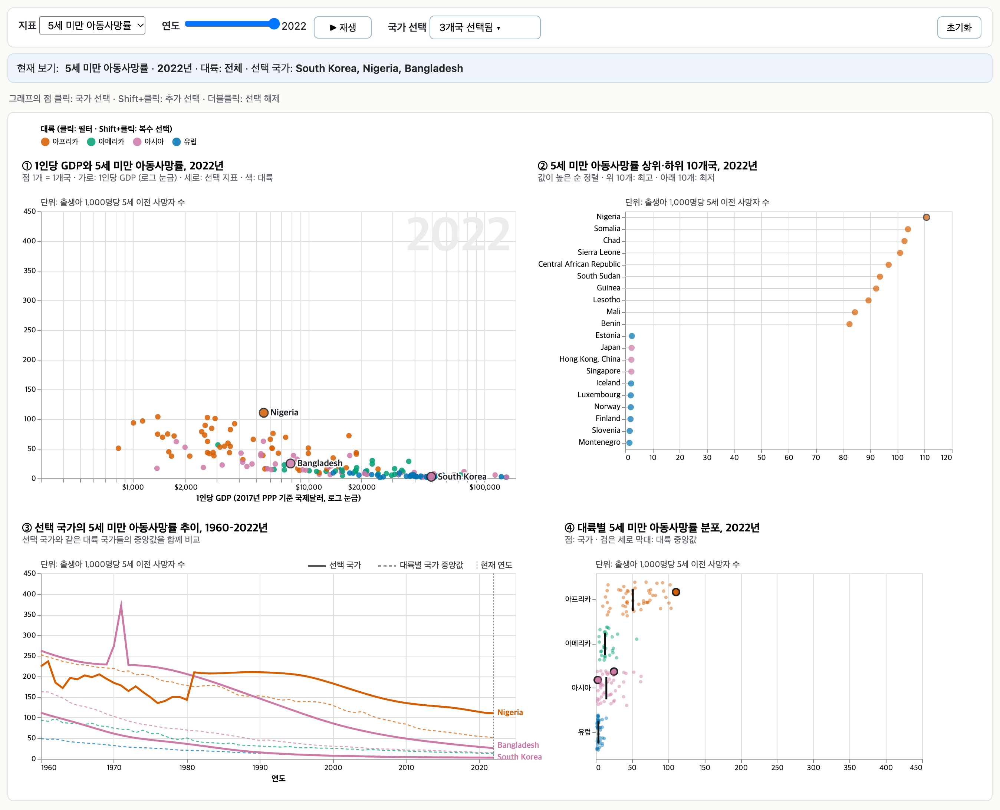
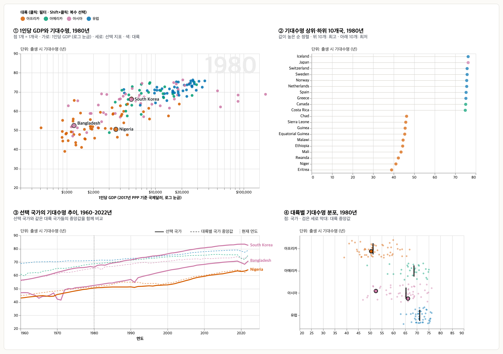
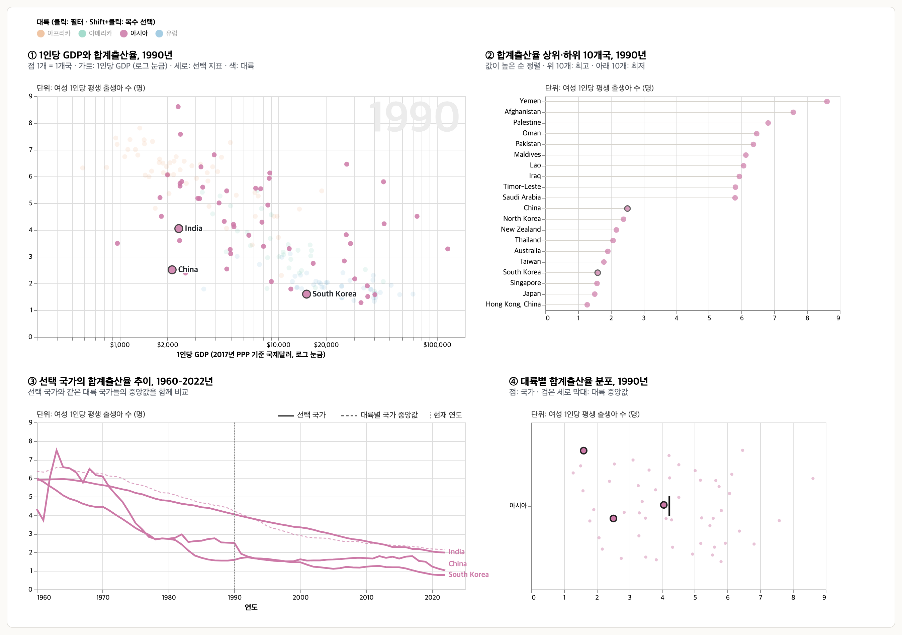
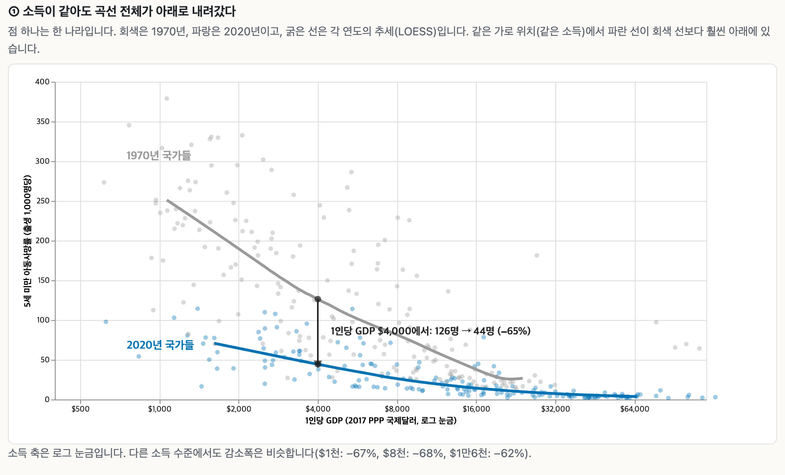
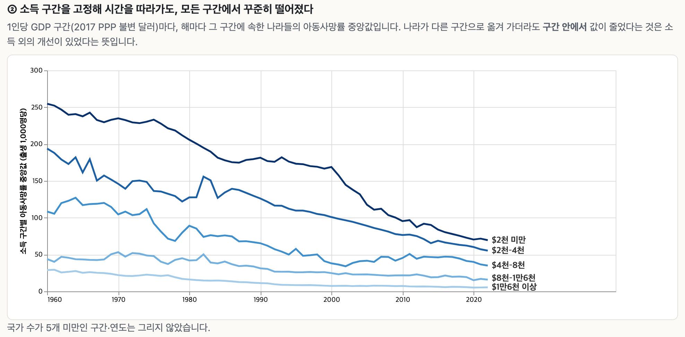
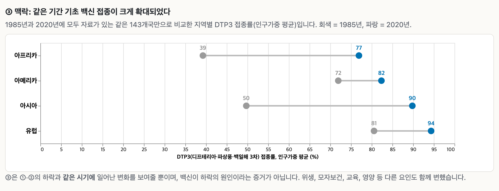

# 데이터 시각화 중간고사 대체 과제 보고서
## 소득과 아동 생존: Gapminder 데이터로 본 1960–2022

| 항목 | 내용 |
|---|---|
| Part A (탐색) | *World Health & Wealth Explorer*: https://sosohan-sonny.github.io/dataviz-gapminder/explore.html |
| Part B (설명) | *같은 소득, 더 적은 죽음*: https://sosohan-sonny.github.io/dataviz-gapminder/explain.html |
| 저장소 | https://github.com/sosohan-sonny/dataviz-gapminder (코드·데이터·보고서) |
| 도구 | Python 3.12 (pandas, statsmodels) → Altair 6 (Vega-Lite 6) → 정적 HTML, GitHub Pages |
| 데이터 | Gapminder Fast Track + World Bank WDI 2개 지표, 179개국, 1960–2022년 |
| 가산점 신청 | ① Part A 온라인 게시 ② Part B 온라인 게시 ③ 데이터 수집·결합·정제 (§5) |

---

## 1. 데이터 수집과 전처리

### 1.1 출처
접근일은 모두 2026-10-23입니다. 파일명과 URL은 `data_sources.md`에 있습니다.

| 지표 | 출처 | 단위 | 용도 |
|---|---|---|---|
| 5세 미만 아동사망률 | Gapminder Fast Track | 출생아 1,000명당 사망자 수 | Part A·B |
| 기대수명 | Gapminder Fast Track | 년 | Part A |
| 합계출산율 | Gapminder Fast Track | 여성 1인당 출생아 수 | Part A |
| 1인당 GDP | Gapminder Fast Track | 2017 PPP 불변 국제달러 | Part A·B |
| 인구 | Gapminder Fast Track | 명 | 가중치, 소국 제외 기준 |
| 국가 메타데이터 (4개 대륙권, ISO3) | Gapminder `ddf--entities--geo--country` | 범주 | 조인 키, 색 |
| DTP3 접종률 | World Bank WDI `SH.IMM.IDPT` (WHO/UNICEF 추정) | % | Part B ③ |
| 5세 미만 사망률 (UN IGME) | World Bank WDI `SH.DYN.MORT` | 출생아 1,000명당 | Part B 교차 검증 |

### 1.2 전처리 단계
스크립트는 `src/prepare.py`, 실행 기록은 `data/processed/prep_log.txt`입니다.

| 단계 | 처리 내용 | 결과 |
|---|---|---|
| 로드·중복 검사 | 5개 지표를 `(country, time)` 키로 outer join | 키 중복 0건 |
| 기간 제한 | 1960–2022년만 사용. Gapminder 파일에는 2100년까지의 추계값이 들어 있어, 관측 기반 기간으로 잘랐습니다. | 12,411행 |
| 메타데이터 조인 | `validate="many_to_one"`으로 1:N 관계를 검증하며 대륙권·ISO3 결합 | 누락 0개국 |
| 소국 제외 | 2022년 인구 15만 명 미만인 17개국. 국가 단위 중앙값을 왜곡하고 산점도를 혼잡하게 만들기 때문입니다. | 예: Andorra, Monaco, Tuvalu |
| 결측 과다 제외 | 핵심 지표 결측이 10%를 넘는 국가 | Holy See |
| 결측 보간 | 국가 내부의 선형보간만 허용하고 양끝 외삽은 하지 않음 | 보간 0셀, 남은 결측 6셀(홍콩 2017–2022 기대수명) |
| 외부 데이터 조인 | World Bank 자료를 ISO3 코드로 결합. 지역 집계 행(WLD, SSF 등)은 Gapminder 국가와 매칭되지 않아 자동으로 빠짐 | DTP3 177/179개국 매칭 |
| 최종 | `data/processed/gapminder_clean.csv` | **179개국 × 63년 = 11,277행** |

### 1.3 표기 불일치·단위·비교 가능성
- **국가명 표기 불일치**: 두 출처는 국가명이 다릅니다(예: Gapminder "Congo, Dem. Rep." / "Hong Kong, China"). 그래서 이름이 아니라 **ISO 3166-1 alpha-3 코드**로 조인했습니다. 매칭되지 않은 2곳(대만은 World Bank 자료에 없음, 홍콩은 DTP3 값이 없음)은 보고서와 출처 문서에 적었습니다.
- **단위 변환**: 따로 변환할 필요가 없었습니다. 소득은 모든 연도가 **2017 PPP 불변 국제달러**이므로 연도 간 같은 소득 구간을 그대로 비교할 수 있습니다. 두 아동사망률(Gapminder, IGME)도 같은 단위(출생아 1,000명당)입니다.
- **표본 구성의 변화**: DTP3는 1980년대 초 보고국이 적습니다(아프리카: 1980년 12개국 → 1985년 47개국). 그래서 Part B ③은 **1985년과 2020년 모두 값이 있는 143개국 고정 패널**로 비교했습니다. 표본이 바뀌어 생기는 착시를 막기 위해서입니다.

### 1.4 데이터 결합으로 가능해진 분석
- **DTP3 결합**: "소득 외에 무엇이 달라졌나"라는 맥락을 보여줄 수 있었습니다(Part B ③).
- **IGME 결합**: Gapminder 추정치에 대한 의존을 독립 출처로 검증할 수 있었습니다(§3.4).

---

## 2. Part A: 탐색 대시보드


*그림 1. Part A 기본 화면(2022년, 5세 미만 아동사망률, 한국·나이지리아·방글라데시 선택)*

### 2.1 사용자, 범위, 탐색 질문
- **사용자**: 국제개발·보건을 공부하는 학생과 일반 독자
- **범위**: 179개국, 1960–2022년, 건강 지표 3종(5세 미만 아동사망률·기대수명·합계출산율)과 1인당 GDP
- **탐색 질문**
  1. 1인당 GDP가 비슷한 국가 사이에서도 건강 수준은 얼마나 다른가?
  2. 특정 국가들(예: 한국·방글라데시·나이지리아)은 언제부터 서로 다른 추이를 보였는가?
  3. 특정 연도에 가장 뒤처지거나 앞선 국가는 어디이며, 어느 대륙에 몰려 있는가?
  4. 대륙 안의 국가 간 편차는 얼마나 크고, 시간이 지나며 줄었는가?

### 2.2 구성: 서로 보완하는 네 개의 뷰
| 뷰 (제목 예시) | 답하는 질문 | 인코딩 | 설계 근거 |
|---|---|---|---|
| ① 1인당 GDP와 5세 미만 아동사망률, 2022년 | Q1 | x = GDP(로그), y = 지표, 색 = 대륙 | 두 양적 변수 모두 공통 척도 위의 위치(#1). 색상은 순서 없는 범주에만 사용 |
| ② 5세 미만 아동사망률 상위·하위 10개국, 2022년 | Q3 | 공통 x축 위의 점과 얇은 줄기, 값 순 정렬 | 막대·파이 대신 dot plot(#1) |
| ③ 선택 국가의 5세 미만 아동사망률 추이, 1960–2022년 | Q2 | 선택 국가는 실선, 대륙 중앙값은 점선 | 공통 척도 위의 위치(#1). 선택하지 않은 국가는 그리지 않아 혼잡을 줄임 |
| ④ 대륙별 5세 미만 아동사망률 분포, 2022년 | Q4 | 대륙별 행, 같은 x축, 중앙값 막대 | 대륙을 별도 패널로 나누지 않고 하나의 x축에 정렬(#2 회피) |

**제목과 레이블 설계**
- 각 그래프 제목은 *무엇을, 언제* 보여주는지 문장으로 적었습니다.
- 지표나 연도를 바꾸면 제목도 함께 바뀌므로, 현재 화면이 어떤 데이터인지 제목만 읽어도 알 수 있습니다.
- 부제에는 읽는 법(점 = 국가, 색 = 대륙)을, 플롯 왼쪽 위에는 정확한 단위를 표시했습니다.

**의도적으로 쓰지 않은 것**
- **인구를 버블 크기로 나타내지 않았습니다.** 면적은 정확도 순위 #4이고, 사람은 면적 비를 과소추정합니다(강의 예시: 실제 6.25배를 3배로 인지). 큰 원이 작은 나라를 가리는 문제도 있어 인구는 툴팁에만 넣었습니다.
- **단계구분도(choropleth)를 쓰지 않았습니다.** 음영·채도는 #6이고, 주변 색에 따라 같은 색이 다르게 보입니다(강의 예시: Colorado/West Virginia). 면적이 큰 나라가 시각적 비중을 과하게 차지하는 문제도 있습니다.
- **누적 막대를 쓰지 않았습니다.** 기준선이 어긋나 #2 과제가 됩니다.

**축과 색 설계**
- **y축 범위 고정**: 지표별로 축 범위를 고정했습니다(아동사망률 0–450, 기대수명 20–90, 출산율 0–9). 연도를 바꿔도 축이 다시 조정되지 않으므로, 점이 움직인 거리가 곧 실제 변화량입니다.
- **로그 눈금**: 소득 축은 300–150,000달러 범위를 한 화면에 담고, 같은 간격이 같은 배수를 뜻하도록 로그 눈금을 썼습니다.
- **대륙 색**: 색각이상에 안전한 Okabe-Ito 팔레트를 썼습니다. ①이 아닌 뷰에서는 범례를 반복하지 않고 같은 색을 공유합니다.
- **국가명 겹침 방지**: 선택한 국가가 많아도 ①③의 국가명이 겹치지 않습니다.
  - 값 순서로 정렬한 뒤 최소 16px 간격으로 세로 위치를 다시 계산하고, 축 상단을 넘지 않게 합니다.
  - 이름이 점에서 멀어지면 가는 지시선으로 연결합니다.
  - 흰 윤곽을 넣어 다른 점 위에서도 읽힙니다.

### 2.3 인터랙션
| 컨트롤 | 효과 |
|---|---|
| 지표 드롭다운 | 네 뷰의 지표를 한 번에 바꿉니다. 제목과 단위 표기도 함께 바뀝니다. |
| 연도 슬라이더 | ①②④가 해당 연도를 보여줍니다. ①의 배경 숫자와 ③의 세로 점선으로 현재 연도를 표시합니다. |
| 국가 선택 드롭다운 | 대륙별로 묶인 179개국 체크박스 목록입니다. 국가명으로 목록을 거를 수 있고, 모두 해제할 수 있습니다. |
| 점 클릭 / Shift+클릭 / 더블클릭 | 국가 선택, 추가 선택, 해제입니다. 드롭다운의 체크 상태와 **양방향으로 동기화**되며, 선택한 국가는 네 뷰에서 모두 강조됩니다(linked views). |
| 범례 클릭 | 대륙 필터입니다. ①은 다른 대륙을 흐리게 하고, ②③④는 해당 대륙만 남깁니다. |
| 툴팁 | 국가, 대륙, 연도, GDP, 세 지표, 인구를 보여줍니다. |
| 상태 표시줄, 초기화 | 현재 지표·연도·대륙·선택 국가를 한 줄 문장으로 보여주고, 초기화 버튼으로 기본 화면에 돌아갑니다. |
| 주소(URL)로 상태 지정 | 예: `explore.html?ind=life_exp&yr=1980&reg=Asia&pick=India,China`. 특정 보기를 링크로 공유하거나 재현할 수 있습니다. |

컨트롤 바는 스크롤해도 화면 위에 고정됩니다. 기본 화면에는 소득과 경로가 다른 한국·방글라데시·나이지리아를 미리 선택해 두어, 처음 열었을 때도 ③에 비교가 보입니다.

### 2.4 사용 예시

*그림 2. 지표 = 기대수명, 연도 = 1980년. ② 하위 10개국은 모두 아프리카이고, ③에서 세 나라의 추이가 1980년(세로 점선) 이후 어떻게 갈라지는지 볼 수 있습니다.*


*그림 3. 지표 = 합계출산율, 연도 = 1990년, 대륙 = 아시아. ①에서 1인당 GDP $2천 안팎의 아시아 국가들끼리도 합계출산율이 2.4명(북한)부터 8.6명(예멘)까지 크게 다르고, ③에서 한국·중국·인도의 출산율 하락 시점 차이를 볼 수 있습니다.*

---

## 3. Part B: 설명 시각화


### 3.1 핵심 메시지
> **같은 소득 수준끼리 비교해도, 2020년 아동의 5세 이전 사망률은 1970년의 약 3분의 1이다.** 아동 생존의 개선은 나라가 부유해졌기 때문만으로는 설명되지 않는다.

- **독자**: 경제성장만 이루면 보건은 따라온다고 생각하는 일반 독자와 정책 입문자
- **왜 중요한가**: 저소득국이 부유해지기를 기다리지 않고도 아동 생존을 크게 개선할 여지가 있음을 시사합니다.

### 3.2 근거 차트와 읽는 순서

**① 두 시점 산점도와 LOESS 추세선 (1970년 회색, 2020년 파랑)**



- 같은 가로 위치(같은 소득)에서 곡선 전체가 아래로 내려간 것을 보여줍니다.
- $4,000 지점에 세로 화살표와 수치를 직접 달았습니다: **126명 → 44명 (−65%)**.
- 다른 소득 수준에서도 감소폭이 비슷합니다: $1천 −67%, $8천 −68%, $1만6천 −62%.
- 국가가 드문 소득 하위·상위 5% 구간은 곡선을 그리지 않았습니다. 1970년 고소득 산유국 몇 곳 때문에 곡선이 다시 올라가는 왜곡을 막기 위해서입니다. 화살표 수치는 전체 범위로 맞춘 곡선에서 계산했습니다.

**② 소득 구간을 고정한 아동사망률 중앙값 추이 (1960–2022)**



- 같은 소득 구간 **안에서도** 모든 구간이 하락했습니다. 국가가 더 부유한 구간으로 옮겨 가서 생긴 효과(구성 효과)를 걷어낸 근거입니다.
- 1970→2020 하락폭: $2천 미만 −70%, $2천–4천 −59%, $4천–8천 −62%, $8천–1만6천 −71%, $1만6천 이상 −77%.
- 순서가 있는 구간이므로 단일 색상의 명도 단계로 표현했고, 범례 대신 선 끝에 직접 레이블을 달았습니다. 레이블은 서로 겹치지 않게 간격을 두었습니다.

**③ 맥락: 대륙별 DTP3 접종률 dumbbell (1985→2020, 143개국 고정 패널)**



- 같은 기간 보건 서비스가 확대되었다는 맥락입니다. 예: 아프리카 39%→77%, 아시아 50%→90%.
- 캡션에 "인과 증거가 아님"을 명시했습니다.

세 차트 모두 필터 없이 고정된 화면입니다. 툴팁은 있지만 메시지를 이해하는 데 필요하지 않습니다.

### 3.3 설계 선택
- **위치(#1) 중심**: ①②의 핵심 비교는 모두 공통 척도 위의 위치로 표현했습니다. 두 연도의 곡선을 별도 패널로 나누지 않고 한 축에 겹쳤습니다. 나누면 #2(비정렬 척도)가 됩니다.
- **곡률 착시 대응**: 강의의 수입/지출 곡선 예시처럼, 두 곡선 사이의 차이를 사람은 수직 거리가 아니라 최단 거리로 읽기 쉽습니다. 그래서 차이를 **세로 화살표와 수치**로 직접 표시했습니다.
- **dumbbell**: ③은 막대 길이 대신 공통 축 위의 두 점과 그 사이 거리로 변화를 보여줍니다.
- **강조와 장식**: 강조색은 파랑 하나, 과거는 회색입니다. 장식 요소(배경 이미지, 3D, 그라데이션)는 쓰지 않았습니다.
- **0에서 시작하는 축**: y축은 0부터 시작해 감소 비율이 과장되지 않게 했습니다.
- **결론형 소제목**: 각 차트의 소제목은 결론 문장이고, 바로 아래 문장이 어떤 데이터인지 설명합니다.

### 3.4 강건성 점검 (Part B 페이지에도 수록)
스크립트는 `src/robustness.py`, 결과는 `data/processed/robustness.json`입니다.

| 점검 | 방법 | 결과 |
|---|---|---|
| **독립 출처로 교차 검증** | 아동사망률을 UN IGME 추정치(`SH.DYN.MORT`)로 바꾸고, 두 해 모두 값이 있는 144개국 고정 패널로 ①을 다시 계산 | 같은 소득에서 1970→2020 감소폭 **57–66%** (같은 패널의 Gapminder 58–67%) |
| 교차 검증 (다른 연도) | IGME, 1980→2015, 165개국 | 감소폭 52–58% |
| 두 출처 일치도 | 1970년 IGME와 Gapminder 비교 | 상관계수 r = 0.979, 중앙 절대차 0.8명 |
| 연도 선택 | 1970/2020 대신 1980/2015, 1960/2022 | 감소폭 53–71% |
| 인구가중 | ②를 인구가중 중앙값으로 재계산 | 다섯 구간 모두 40–76% 하락 |
| 최저 소득 구간 구성 | 2020년 $2천 미만 국가 확인 | 소말리아·중앙아프리카공화국·남수단·예멘 등 분쟁·취약국 중심. 이 구간의 2020년 값을 끌어올리므로 실제 개선 폭은 그래프보다 클 수 있음(보수적 추정) |

IGME 추정치는 가구조사·인구동태 자료로 만들며 소득을 입력으로 쓰지 않습니다. 따라서 "소득으로 추정한 값이라 생긴 결과"라는 반론을 배제할 수 있습니다.

### 3.5 한계
- **상관이지 인과가 아닙니다.** 이 분석은 "소득만으로는 설명되지 않는다"는 것까지만 보여줍니다. ③은 같은 시기에 일어난 일이지 원인의 증거가 아닙니다.
- **국가 단위 자료(생태학적 오류)**: 국가 내부 소득 계층의 차이는 다루지 않습니다.
- **데이터 불연속**: 출처가 바뀌는 해에 불연속이 있는 경우가 있습니다(예: 나이지리아 아동사망률 1980년 143 → 1981년 210).
- **PPP 소득**: PPP 환산 소득은 국가 간 비교를 위한 근사치입니다.
- **LOESS 평활 정도**: frac = 0.6은 분석자가 정한 값입니다. 화살표 수치는 이 곡선에서 보간한 값입니다.

---

## 4. 재현 방법
```
python3 -m venv .venv && .venv/bin/pip install -r requirements.txt
.venv/bin/python src/prepare.py      # 정제·결합
.venv/bin/python src/robustness.py   # 강건성 점검
.venv/bin/python src/part_a.py       # → docs/explore.html
.venv/bin/python src/part_b.py       # → docs/explain.html
.venv/bin/python src/screenshots.py  # 보고서 그림 (Chrome 필요)
```

## 5. 가산점 신청 항목
1. **온라인 게시 (Part A, Part B)**: GitHub Pages URL에서 인터랙션이 그대로 동작합니다(로그인 없이 접속 가능하도록 공개 저장소로 게시).
2. **데이터 수집·결합·정제**
   - 서로 다른 두 출처(Gapminder 지표 5종과 메타데이터, World Bank의 WHO/UNICEF 접종률과 UN IGME 아동사망률)를 ISO3 코드로 결합했습니다.
   - 추계값을 제거하고, 기준을 정해 소국·결측 국가를 제외했습니다.
   - 접종 자료의 표본 변화는 고정 패널로 보정했습니다.
   - 결합한 IGME 자료로 핵심 메시지를 독립 출처에서 교차 검증했습니다.
   - 전체 과정을 스크립트와 로그로 재현할 수 있습니다.

## 6. 참고문헌
- Cleveland, W. S., & McGill, R. (1984). Graphical perception: Theory, experimentation, and application to the development of graphical methods. *JASA*, 79(387), 531–554.
- Gapminder Foundation. Fast Track indicators. https://www.gapminder.org/data/
- World Bank. World Development Indicators: SH.IMM.IDPT, SH.DYN.MORT. https://data.worldbank.org/
- UN Inter-agency Group for Child Mortality Estimation (UN IGME). https://childmortality.org/
